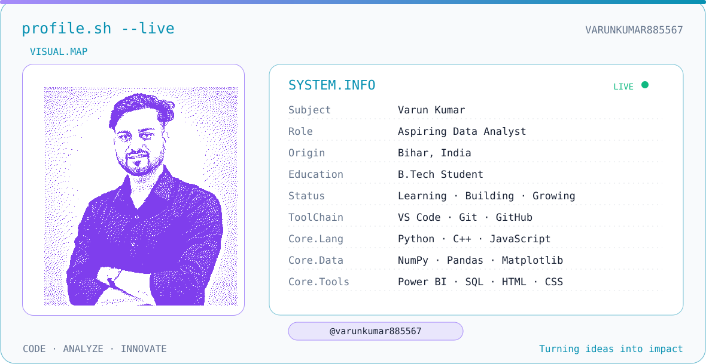

<!-- ================= PROFILE BANNER ================= -->

<picture>
  <source media="(prefers-color-scheme: dark)" srcset="dark.svg">
  <source media="(prefers-color-scheme: light)" srcset="light.svg">
  
</picture>

<h1 align="center">Hi 👋, I'm Varun Kumar</h1>

<h3 align="center">Aspiring Data Analyst | Python Developer | AI & ML Enthusiast</h3>

  

  

---

## 👨‍💻 About Me

- 🎓 Currently pursuing B.Tech at Gulzar Group of Institutions.
- 📊 Aspiring Data Analyst.
- 💻 Interested in Data Analytics, AI and Machine Learning.
- 🌱 Learning Python, SQL and Data Visualization.
- 🚀 Building practical real-world projects.
- 🎯 Goal: Become a skilled Data Analyst and Software Developer.

---

## 🛠️ Technical Skills

### Programming Languages

  

### Data Analytics & Tools

  

- Python
- NumPy
- Pandas
- Matplotlib
- Power BI
- SQL
- Jupyter Notebook

---

## 📊 GitHub Analytics

  
  

---

## 🔥 Contribution Streak

  

---

## 🐍 Contribution Snake Animation

  <picture>
    <source media="(prefers-color-scheme: dark)" srcset="https://raw.githubusercontent.com/varunkumar885567/varunkumar885567/output/github-snake-dark.svg">
    <source media="(prefers-color-scheme: light)" srcset="https://raw.githubusercontent.com/varunkumar885567/varunkumar885567/output/github-snake.svg">
    
  </picture>

---

## 🚀 Featured Projects

### 📈 1. Sales Data Analysis Dashboard

- Sales data analysis using Python and Pandas.
- Monthly sales and profit analysis.
- Interactive Streamlit dashboard.
- Business insights and visualization.

🔗 [Live Dashboard](https://sales-data-analysis-jhduhgevbfm6jmatfx7dkm.streamlit.app/)

### 🎓 2. Student Stress Prediction

- Machine Learning prediction model.
- Logistic Regression.
- Decision Tree Classifier.
- Academic and lifestyle parameter analysis.

### 🌐 3. Personal Portfolio Website

- Responsive personal portfolio.
- HTML, CSS and JavaScript.
- Professional developer profile.

---

## 🎬 Project Demo Video

  

  ▶️ Click the thumbnail to watch my project demo.

---

## 📚 Currently Learning

- Advanced Python
- SQL for Data Analysis
- Data Visualization
- Machine Learning
- AI-powered Full Stack Development

---

## 🌐 Connect With Me

  

  

---

<h3 align="center">✨ Learning • Building • Growing ✨</h3>

  Thank you for visiting my GitHub profile!

M
